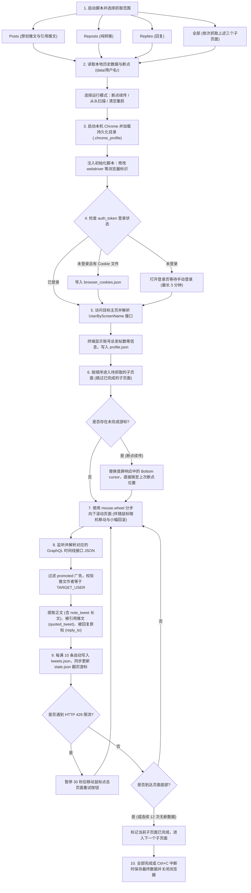

# X Crawler

基于 Playwright 的 X（Twitter）公开时间线数据抓取工具。程序通过浏览器访问目标账号主页并向下滚动，监听并解析后台返回的 GraphQL 接口 JSON 数据，提取目标账号的原创推文、转推和回复（包含被回复的原帖与被引用的原帖内容），按推文 ID 去重后保存为 JSON 文件。

> 本工具仅用于小规模、低频率的数据采集，使用时请遵守当地法律法规与 X 服务条款。

## 功能说明

### 运行逻辑与功能结构图



### 按运行顺序的功能说明

1. **选择抓取范围与读取本地断点**
   - 启动后在终端选择要抓取的内容类型：原创推文（`Posts`）、纯转推（`Reposts`）、回复（`Replies`）或全部。
   - 自动读取 `data/<TARGET_USER>/` 目录下已有的 `tweets.json`（历史推文）和 `state.json`（上次记录的翻页游标与已完成子页面列表）。若本地已有数据，可选择断点续传、从头扫描或清空重抓。
2. **启动本地浏览器与修改自动化标识（`stealth.py`）**
   - 启动本机安装的 Google Chrome，加载 `.chrome_profile/` 目录中的浏览器配置与缓存。
   - 在页面加载前注入脚本，隐藏 `navigator.webdriver` 标识、设置 `navigator.languages` 语言列表、补充 `window.chrome.runtime` 属性。
3. **检查与保持登录状态**
   - 检查浏览器会话中是否存在有效的 `auth_token` Cookie：若已存在则直接进入抓取流程；若不存在但项目根目录下有 `browser_cookies.json`，则自动导入该文件中的 Cookie；若均无，则在打开的 Chrome 窗口中跳转登录页，等待用户手动完成登录（最长等待 3 分钟），登录状态自动保存在 `.chrome_profile/` 中供后续复用。
4. **获取并显示目标账号基本信息**
   - 进入目标用户主页时，监听并解析后台 `UserByScreenName` 接口返回的 JSON 数据。
   - 在开始滚动抓取前，于终端显示目标账号的昵称、总发帖数、媒体帖数、关注数、粉丝数以及本地已保存的推文条数，并将账号资料保存至 `data/<TARGET_USER>/profile.json`。
5. **切换子页面与注入断点游标**
   - 按所选范围依次访问 `Posts`（`/user`）、`Reposts`（`/user/reposts`）、`Replies`（`/user/with_replies`）三个子页面；在不同子页面之间切换时，先滚动回页面顶部，再移动鼠标点击对应的顶部标签。
   - 若处于断点续传模式：已抓取到底部的子页面会直接跳过；未抓完的子页面会在首屏接口返回时将翻页游标（`Bottom cursor`）替换为上次中断时保存的游标，使下一次滚动直接从中断位置向后请求数据。
6. **模拟鼠标滚轮滚动与鼠标移动点击（`stealth.py`）**
   - 在子页面中通过 `page.mouse.wheel()` 分多次向下滚动页面以触发翻页请求，滚动间隙随机移动鼠标位置或小幅向上回滚。
   - 点击页面元素（如切换顶部标签页或点击重试按钮）时，记录上一次鼠标停留坐标，按曲线轨迹分步移动鼠标至目标元素内部后再执行按下与抬起操作。
7. **监听 GraphQL 接口并过滤非目标数据**
   - 通过 Playwright 的 `page.on("response", ...)` 分别监听 `UserOriginalsTimeline`（原创推文）、`UserRepostsTimeline`（纯转推）和 `UserRepliesTimeline`（回复）接口返回的 JSON 数据，不依赖前端 DOM 标签结构。
   - 遍历 JSON 数据时跳过 `entryId` 以 `promoted-` 开头的广告条目，并检查每条推文的作者用户名是否与 `TARGET_USER` 一致，排除 `/with_replies` 页面对话串中由其他用户发布的被回复原帖。
8. **提取推文全文与关联上下文**
   - **超过 280 字的长推文**：优先读取 JSON 中的 `note_tweet` 字段获取未截断全文，并将 HTML 转义字符（如 `&amp;`、`&gt;`）还原为普通字符。
   - **纯转推（`type = "retweet"`）**：从内嵌的 `retweeted_status_result` 字段中提取原作者用户名（`original_author`）与未截断的原帖全文。
   - **被引用的推文（`quoted_tweet`）**：当推文包含引用转发（Quote Post）时，从 `quoted_status_result` 字段中提取被引用原帖的 ID、作者、发布时间与正文。
   - **被回复的原帖（`reply_to`）**：当推文属于回复（`type = "reply"`）时，从同一接口返回的对话列表中查找被回复的上游原帖，记录其 ID、作者、发布时间与正文。
9. **定时保存、限流等待与结束归档**
   - 抓取过程中每新增 10 条推文自动写入 `data/<TARGET_USER>/tweets.json`，每次翻页同步将最新游标写入 `data/<TARGET_USER>/state.json`（均采用临时文件替换方式写入，防止按 `Ctrl+C` 中断时损坏文件）。
   - 当接口返回 HTTP 429 状态码（请求频率限制）时，程序暂停 30 秒，随后移动鼠标点击页面上的重试按钮继续抓取。
   - 当子页面滚动到底部（接口返回空页或连续 12 次滚动无新数据）时，将该子页面记入已完成列表；全部子页面抓取结束或按 `Ctrl+C` 退出时，保存最终去重排序后的 JSON 文件并关闭浏览器。

## 环境要求

- Python 3.12 或更高版本
- [uv](https://docs.astral.sh/uv/)
- 本机已安装 Google Chrome（或使用 Playwright 内置 Chromium）
- 可访问 `x.com` 的网络环境

## 安装与配置

```bash
git clone <repository-url>
cd X_Crawler
uv sync
cp .env.example .env
```

如果本机未安装 Google Chrome，可安装 Playwright 内置 Chromium：

```bash
uv run playwright install chromium
```

### 环境变量说明（`.env`）

| 变量名 | 默认值 | 说明 |
| --- | --- | --- |
| `TARGET_USER` | `bhupen07` | 目标 X 账号的用户名（不带 `@`） |
| `DATA_DIR` | `data` | 数据文件的保存根目录 |
| `SINCE_DATE` | 空（不限制） | 可选：抓取起始日期（含当天，格式 `YYYY-MM-DD`，如 `2025-01-01`）；滚动到早于该日期的推文时自动停止当前子页面 |
| `UNTIL_DATE` | 空（不限制） | 可选：抓取结束日期（含当天，格式 `YYYY-MM-DD`，如 `2025-12-31`）；晚于该日期的推文跳过不保存 |
| `CHROME_PATH` | 自动查找本机 Chrome | 本机 Google Chrome 可执行文件路径（macOS 默认 `/Applications/Google Chrome.app/Contents/MacOS/Google Chrome`） |
| `CHROME_USER_DATA_DIR` | `.chrome_profile` | 本地 Chrome 用户数据目录，用于保存登录状态 |
| `PROXY` | 空（使用系统网络） | 可选代理地址，例如 `http://127.0.0.1:7890` |
| `HEADLESS` | `false` | 是否使用无头模式运行浏览器（`true` / `false`） |

## 登录方式

程序启动本机 Google Chrome，并将浏览器数据保存在 `.chrome_profile/` 目录中：

1. **在浏览器窗口中手动登录**：首次运行 `uv run python main.py` 时，如果 `.chrome_profile/` 中没有有效的 `auth_token` Cookie，程序会打开登录页面并等待用户完成登录（最长等待 3 分钟）。登录后程序自动开始抓取，后续运行直接复用该目录中的登录状态。
2. **从文件导入 Cookie**：如果 `.chrome_profile/` 中尚未登录，且项目根目录下存在 `browser_cookies.json`，程序启动时会将文件中的 Cookie 写入浏览器会话。

## 运行与使用

执行以下命令启动程序：

```bash
uv run python main.py
```

启动后可输入编号选择要抓取的内容类型（多选用空格分隔，直接按回车默认选 `4`）：

| 选项 | 访问地址 | 对应 GraphQL 接口 | 抓取内容 |
| --- | --- | --- | --- |
| `1` | `x.com/<user>`（`Posts`） | `UserOriginalsTimeline` | 原创推文 Posts（含纯原创推文与带评论引用推文） |
| `2` | `x.com/<user>/reposts`（`Reposts`） | `UserRepostsTimeline` | 纯转推 Reposts（直接一键转发他人的推文） |
| `3` | `x.com/<user>/with_replies`（`Replies`） | `UserRepliesTimeline` | 回复 Replies（含被回复原帖与引用推文上下文） |
| `4` 或直接回车 | 依次访问 `Posts`、`Reposts`、`Replies` | 上述全部三个接口 | 依次抓取三个子页面并按 ID 去重合并 |

当页面到底部或连续 12 次滚动没有新数据时，当前子页面抓取结束。数据保存在 `data/<TARGET_USER>/` 目录下：

```text
data/<TARGET_USER>/
├── tweets.json    # 推文列表（按发布时间从新到旧排序）
├── profile.json   # 账号基本信息（总发帖数、媒体帖数、粉丝数、简介等）
└── state.json     # 翻页游标与子页面完成状态
```

如果本地已存在历史数据或未完成的翻页游标，启动时可选择：
1. **断点续传（默认）**：已抓取到底部的子页面直接跳过，未完成的子页面从上次记录的游标位置继续向后抓取。
2. **从头扫描**：从页面顶部最新推文开始向下滚动，抓取结果与本地已有数据合并去重。
3. **清空重抓**：删除本地已保存的推文与游标记录，重新开始抓取。

### 输出 JSON 结构说明

```json
[
  {
    "id": "1880000000000000000",
    "created_at": "2025-01-15T08:30:00Z",
    "author": "bhupen07",
    "type": "reply",
    "original_author": "",
    "text": "目标用户发布的回复正文",
    "reply_to": {
      "id": "1879999999999999999",
      "author": "some_user",
      "created_at": "2025-01-15T08:00:00Z",
      "text": "被回复的原帖正文"
    },
    "quoted_tweet": {
      "id": "1878888888888888888",
      "author": "another_user",
      "created_at": "2025-01-14T12:00:00Z",
      "text": "被引用的推文正文"
    }
  }
]
```

字段含义：
- `id`：推文 ID
- `created_at`：UTC 发布时间（ISO 8601 格式，如 `2025-01-15T08:30:00Z`）
- `author`：发布该推文的用户名（`screen_name`）
- `type`：推文类型，取值为 `tweet`（原创推文或带评论引用推文）、`retweet`（不带评论的纯转推）或 `reply`（回复）
- `original_author`：当 `type` 为 `retweet` 时记录被转发原帖的作者用户名，其他类型为空字符串
- `text`：推文全文（当 `type` 为 `retweet` 时，记录被转发原帖的全文）
- `reply_to`：当 `type` 为 `reply` 时，记录被回复原帖的 `id`、`author`、`created_at` 和 `text`；非回复时为 `null`（若被回复原帖已被删除或不可见，则 `text` 和 `created_at` 为 `null`）
- `quoted_tweet`：当推文引用了其他推文时，记录被引用推文的 `id`、`author`、`created_at` 和 `text`；未引用时为 `null`

## X 个人主页帖子分类与接口说明（记录于 2026-11-06）

> **编写日期：2026 年 11 月 6 日**（基于当日 X 网页端个人主页结构整理，供后续编写或维护 X 采集脚本参考）。

### 1. 账号总发帖数（`total_tweets`）的计算方式

个人主页顶部以及 `UserByScreenName` 接口（`legacy.statuses_count` 或 `tweet_counts.tweets`）显示的**帖子总数**，等于以下三类帖子的数量之和：

$$\text{帖子总数} = \text{Posts（原创推文 + 带评论引用推文）} + \text{Reposts（纯转推）} + \text{Replies（回复）}$$

这三类内容在网页端分别位于三个不同的标签页下，因此单独抓取其中某一个标签页得到的数量会少于账号显示的帖子总数。

---

### 2. 第一层：个人主页顶部的四个标签页（`Posts ⌄` | `Replies` | `Reposts` | `Media`）

X 个人主页顶部共有 4 个标签页，前 3 个分别对应上述三类帖子，第 4 个为附件筛选列表：

| 顶部标签 | 页面 URL | 包含内容 | 对应 `type` 值 | 后台 GraphQL 接口名 | 说明 |
| :--- | :--- | :--- | :--- | :--- | :--- |
| **`Posts ⌄`** | `https://x.com/<user>` | 用户自己发布的纯原创推文、带评论的引用推文（Quote Post） | `"tweet"` | `UserOriginalsTimeline`<br>*(切换为 All 时调用 `UserTweets`)* | 打开个人主页时默认选中二级菜单中的 `Posts ✓`，只返回原创与引用推文，不包含纯转推（`Reposts`）。 |
| **`Replies`** | `https://x.com/<user>/with_replies` | 用户在他人或自己帖子下发布的回复，以及对应的被回复原帖 | `"reply"`<br>*(若对话中包含目标用户自己的主贴则为 `"tweet"`)* | `UserRepliesTimeline`<br>*(旧版接口名为 `UserTweetsAndReplies`)* | 只返回回复所在的对话串，不包含没有回复的普通原创推文和纯转推。接口返回的数据中同时包含其他用户发布的被回复原帖，解析时需核对推文作者是否为目标用户。 |
| **`Reposts`** | `https://x.com/<user>/reposts` | 用户未添加评论、直接转发他人的推文（即 `RT @xxx`） | `"retweet"` | `UserRepostsTimeline` | 单独列出所有的纯转推。接口外层节点的 `full_text` 通常以 `RT @原作者:` 开头且会被截断，未截断的完整原文位于内嵌的 `legacy.retweeted_status_result.result` 字段中。 |
| **`Media`** | `https://x.com/<user>/media` | 该账号所有包含图片、GIF 或视频的推文 | 非独立分类 | `UserMedia` | 对应账号信息中的 `media_tweets`（媒体帖数）。该列表只是筛选出带图片或视频的帖子，其中的帖子已经包含在前面三个标签页中。 |

---

### 3. 第二层：点击 `Posts ⌄` 弹出的下拉菜单（`All` | `Posts ✓` | `Highlights` | `Sort by`）

点击第一个标签 **`Posts ⌄`** 右侧的箭头，会展开四个下拉选项：

1. **`All`（原创推文 + 纯转推）**
   - 将该用户的 **`Posts`（原创推文与带评论引用推文）** 和 **`Reposts`（纯转推）** 合并在同一个列表中按时间展示，不包含 `Replies`（回复）。
   - 后台对应 `UserTweets` 接口。
2. **`Posts ✓`（仅原创推文，默认选中）**
   - 仅展示该用户自己撰写的推文（包含纯原创推文与带评论引用推文），不显示纯转推（`Reposts`）。
   - 后台对应 `UserOriginalsTimeline` 接口，直接访问 `https://x.com/<user>` 时默认加载该视图。
3. **`Highlights`（精选）**
   - 展示账号主人手动添加至精选列表的推文（仅开通 X Premium 的账号可使用该功能）。
   - 后台对应 `UserHighlightsTweets` 接口。
4. **`Sort by >`（排序方式）**
   - 用于选择列表的排序方式：默认按发布时间从新到旧排序（`Latest`），也可切换为按点赞数或互动量排序。按时间排序时接口会返回用于翻页的 `Bottom cursor`。

---

### 4. GraphQL 接口 JSON 中的推文类型判断字段

在解析 GraphQL 接口返回的单个推文对象（`tweet_results.result`）时，可通过以下 JSON 字段区分不同类型并提取内容：

| 类型 | JSON 判断条件 | 内容提取位置 |
| :--- | :--- | :--- |
| **纯原创推文**<br>(`type = "tweet"`) | 不含 `legacy.retweeted_status_result`，且不含 `legacy.in_reply_to_status_id_str` | 若存在 `note_tweet.note_tweet_results.result.text`（超过 280 字的长推文）则读取该字段；否则读取 `legacy.full_text`。 |
| **带评论引用推文**<br>(`type = "tweet"`，含 `quoted_tweet`) | 存在 `quoted_status_result.result`，且不含 `legacy.retweeted_status_result` | 用户自己写的评论从外层 `note_tweet` 或 `legacy.full_text` 读取；被引用的原帖信息从内嵌的 `quoted_status_result.result` 对象中读取。 |
| **纯转推**<br>(`type = "retweet"`) | 存在 `legacy.retweeted_status_result.result` | 外层 `legacy.full_text` 会被截断；需从 `legacy.retweeted_status_result.result` 中读取原作者用户名与原帖完整正文。 |
| **回复**<br>(`type = "reply"`，含 `reply_to`) | 存在 `legacy.in_reply_to_status_id_str`（或 `in_reply_to_user_id_str`） | 被回复原帖的 ID 保存在 `in_reply_to_status_id_str`；被回复原帖的正文可从同一批次响应的对话条目（`TimelineTimelineModule.items`）中按推文 ID 匹配获取。 |
| **广告推文（需过滤）** | 外层条目 `entryId` 以 `"promoted-"` 开头，或包含 `promotedMetadata` 字段 | 属于推广广告，解析时直接跳过。 |
| **受限或已删除推文** | `__typename` 为 `TweetWithVisibilityResults`、`TweetTombstone` 或 `TweetUnavailable` | `TweetWithVisibilityResults` 的实际推文数据包裹在内层 `.tweet` 字段中；`TweetTombstone` 与 `TweetUnavailable` 表示推文已删除或无权限查看，不包含正文数据。 |

## 项目结构

```text
.
├── main.py          # 抓取主程序（浏览器控制、接口监听、数据解析与断点保存）
├── stealth.py       # 浏览器属性修改与鼠标移动、滚轮滚动、点击模拟
├── .env.example     # 环境变量配置示例
├── pyproject.toml   # 项目依赖配置
└── uv.lock          # 依赖版本锁定文件
```

运行过程中生成的本地文件（已在 `.gitignore` 中忽略）：

```text
.env                  # 本地环境变量配置
.chrome_profile/      # 本地 Chrome 登录状态与缓存目录
browser_cookies.json  # 可选的导入 Cookie 文件
data/                 # 抓取结果保存目录
```

## 常见问题

- **如何切换登录的 X 账号？**
  删除项目根目录下的 `.chrome_profile/` 文件夹（如果存在 `browser_cookies.json` 也一并删除），重新运行 `uv run python main.py`，在弹出的 Chrome 窗口中登录新账号即可。
- **遇到“触发 X 接口频率限制 (429)”提示怎么办？**
  X 对单个账号在短时间内的翻页请求次数有限制。程序检测到 429 状态码后会自动等待 30 秒，并点击页面上的重试按钮继续抓取。
- **如何使用无头模式在后台运行？**
  先在默认有头模式下运行一次并完成登录（使登录状态保存在 `.chrome_profile/` 中），之后在 `.env` 中将 `HEADLESS` 设为 `true`。
